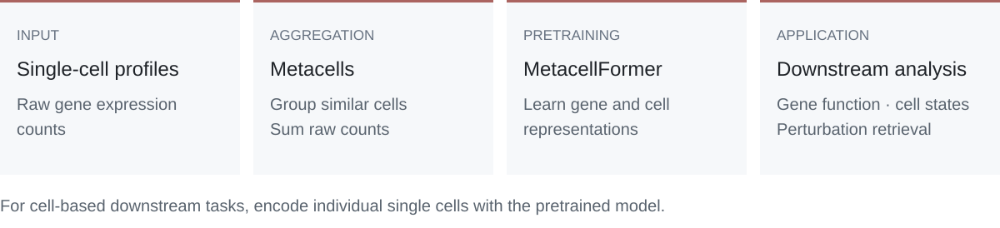

<p align="center">
  
</p>

<p align="center">
  <a href="#overview">Overview</a>
  &nbsp;·&nbsp;
  <a href="#getting-started">Getting started</a>
  &nbsp;·&nbsp;
  <a href="#tutorials">Tutorials</a>
  &nbsp;·&nbsp;
  <a href="#data-and-models">Models &amp; data</a>
  &nbsp;·&nbsp;
  <a href="benchmarks/README.md">Benchmarks</a>
</p>

**MetacellFormer** learns gene and cell representations through pretraining on metacells constructed by summing raw counts across transcriptionally similar cells. This repository provides tutorials for using the pretrained model and workflows for metacell construction, pretraining, and evaluation.

## Overview

<p align="center">
  
</p>

## Getting started

1. Follow the [installation instructions](#installation) to set up the main environment.
2. Download the model and evaluation files listed in the [embedding tutorial](examples/02_embeddings.ipynb), and set their [local paths](#data-and-models).
3. Start Jupyter from the repository root and open [02_embeddings.ipynb](examples/02_embeddings.ipynb) to extract single-cell embeddings.

**Start with notebook 02 to use the pretrained encoder.** MetaQ is needed only for metacell construction; it is not required for pretrained inference.

## Installation

Use Python 3.11 on Linux or WSL. Run the following commands from the repository root:

```bash
python3.11 -m venv MetacellFormer-env
source MetacellFormer-env/bin/activate
python -m pip install --upgrade pip
python -m pip install torch==2.4.0 --index-url https://download.pytorch.org/whl/cpu
python -m pip install -r configs/evaluation-requirements.txt '.[evaluation,test]'
python -m pip check
python -m pytest -q tests
```

These commands install the CPU build of PyTorch. For GPU inference or training, use a CUDA build of PyTorch. See [configs/README.md](configs/README.md) for environment specifications and external encoder settings.

## Data and models

| Repository | Contents |
|---|---|
| [MetacellFormer](https://huggingface.co/netbiolab/MetacellFormer) | Metacell-pretrained checkpoint, vocabulary and reference statistics |
| [MetacellFormer-SC](https://huggingface.co/netbiolab/MetacellFormer-SC) | Matched single-cell-pretrained checkpoint and resources |
| [MetacellFormer-corpus](https://huggingface.co/datasets/netbiolab/MetacellFormer-corpus) | 818,609 metacell count profiles, source-cell memberships and fixed splits from 1,334 datasets |
| [MetacellFormer-evaluation](https://huggingface.co/datasets/netbiolab/MetacellFormer-evaluation) | Inputs, cell rosters, labels and folds for six main benchmarks, Gaussian noise robustness and PC9 evaluation |

**MetacellFormer-SC** is the matched single-cell-pretrained control for assessing the effect of metacell pretraining.

Download the files required by the notebook you plan to run. Set the following environment variables to your local resource directories before starting Jupyter:

```bash
export METACELLFORMER_EVALUATION=/path/to/MetacellFormer-evaluation
export METACELLFORMER_MODEL=/path/to/MetacellFormer
```

Dataset manifests record source access, expression types and usage terms. The corpus README describes how to reconstruct the corpus from the original single-cell providers.

## Tutorials

Start Jupyter from the repository root. Each notebook writes its outputs to `example_outputs/`.

| Notebook | Environment | Workflow |
|---|---|---|
| [01_metaq.ipynb](examples/01_metaq.ipynb) | MetaQ-env | Group 100 K562 cells into metacells and aggregate raw counts |
| [02_embeddings.ipynb](examples/02_embeddings.ipynb) | MetacellFormer-env | Extract embeddings for 96 fixed human PBMC_368K cells |
| [03_evaluation.ipynb](examples/03_evaluation.ipynb) | MetacellFormer-env | Evaluate PBMC_368K cell-type annotation and robustness under one Gaussian noise condition |
| [04_perturbation_retrieval.ipynb](examples/04_perturbation_retrieval.ipynb) | MetacellFormer-env | Evaluate retrieval of matching perturbation responses and functionally related perturbations in K562 cells |

Each notebook documents its required downloads, runtime, output files and completion checks, and includes a small executed example. Run notebook 03 after notebook 02. Notebook 04 can be run independently.

Cell-based downstream workflows encode individual single cells. In notebook 04, cell embeddings are aggregated by perturbation and batch after inference.

<details>
<summary><strong>Register a Jupyter kernel</strong></summary>

Activate the main environment and run:

```bash
python -m pip install ipykernel
python -m ipykernel install --user --name MetacellFormer-env --display-name "Python (MetacellFormer-env)"
```

For the MetaQ tutorial, activate `MetaQ-env`, install `ipykernel`, and register it using `MetaQ-env` as the kernel name and `Python (MetaQ-env)` as the display name.

</details>

## Evaluation

Copy [configs/runtime.example.json](configs/runtime.example.json) to `runtime.json` and set the checkpoint paths for the models you plan to evaluate. Follow [benchmarks/README.md](benchmarks/README.md) for embedding extraction, the six main benchmark tasks, Gaussian noise robustness and PC9 evaluation. Use `metacellformer.load_encoder` to load either the MetacellFormer or MetacellFormer-SC checkpoint.

The benchmark workflows include MetacellFormer, Geneformer-V2, Geneformer-V1, scPRINT, scGPT and CellFM. MetacellFormer-SC provides the matched pretraining control. Results reported in the manuscript are provided in the accompanying Figure Source Data and Supplementary Tables.

## Metacells and pretraining

The workflow below covers metacell construction and preparation for metacell-based pretraining. MetaQ runs in a separate Python 3.10 environment; tokenization and model pretraining use the main environment.

<details>
<summary><strong>Metacell construction and pretraining instructions</strong></summary>

### Set up MetaQ

Install [MetaQ](https://github.com/XLearning-SCU/MetaQ) in a separate Python 3.10 environment:

```bash
python3.10 -m venv MetaQ-env
source MetaQ-env/bin/activate
python -m pip install --upgrade pip
python -m pip install torch==2.1.1 --index-url https://download.pytorch.org/whl/cpu
python -m pip install -r configs/metaq-requirements.txt
METAQ_DIR=$(python -c 'import importlib.util; print(next(iter(importlib.util.find_spec("MetaQ_sc").submodule_search_locations)))')
patch --dry-run -d "$METAQ_DIR" -p1 < patches/metaq.patch
patch -d "$METAQ_DIR" -p1 < patches/metaq.patch
python -m pip check
python tests/check_metaq.py
```

Apply the patch once to a clean installation. It preserves CP10K/log1p preprocessing, HVG selection and the original training loop, and exports cell memberships for raw-count aggregation.

MetaQ uses seed 1, 300 epochs, Random initialization and `max(1, floor(n_cells/50))` groups. Inputs with fewer than 50 cells are assigned directly to one group. For the 100-cell tutorial, use `--device cpu --batch-size 16`.

### Construct metacells and prepare pretraining data

```bash
python scripts/prepare_metaq.py --input counts.h5ad --output-dir metaq --device cpu
python scripts/aggregate_metacells.py counts.h5ad metaq/memberships.tsv metacells.h5ad --source-id SOURCE
# After aggregation, deactivate MetaQ and activate the main environment.
deactivate
source MetacellFormer-env/bin/activate
python -m pip install -c configs/evaluation-requirements.txt '.[training]'
python scripts/tokenize_training.py --input metacells.h5ad --model-dir MODEL_DIRECTORY --split split.tsv --dataset-id SOURCE --dataset-idx 0 --output-dir tokens
python scripts/build_training_shards.py --token_index_csv tokens/token_index.csv --out_train_dir train --out_eval_dir eval --out_prefix metacells --max_input_size 1024
python scripts/train_paper.py --help
```

Aggregation sums raw counts across all measured genes. Use `--counts-layer` when counts are stored in an AnnData layer.

The split TSV contains `profile_id` and `split` (`train` or `eval`) in input row order. Combine source token-index CSVs before building corpus shards.

The model repository supplies reference medians and fixed 64-bin edges. [configs/pretraining.json](configs/pretraining.json) specifies the training schedule. Run `train_paper.py --dry-run` to print the launch commands.

</details>

## Repository layout

| Directory | Contents |
|---|---|
| `src/metacellformer/` | Encoder, tokenizer, value bins and training runtime |
| `scripts/` | MetaQ, aggregation and data preparation |
| `benchmarks/` | Embedding extraction, evaluation and manuscript analysis code |
| `configs/` | Environments, checkpoints and training schedules |
| `examples/`, `tests/` | Workflow notebooks and consistency checks |

[GitHub Actions](.github/workflows/tests.yml) runs the tests and a separate MetaQ check on pushes and pull requests.

## License

Code: [Apache License 2.0](LICENSE). The MetaQ patch retains its [MIT notice](patches/MetaQ-LICENSE.txt). Model weights: CC BY 4.0. Datasets and upstream model code retain their source terms.
